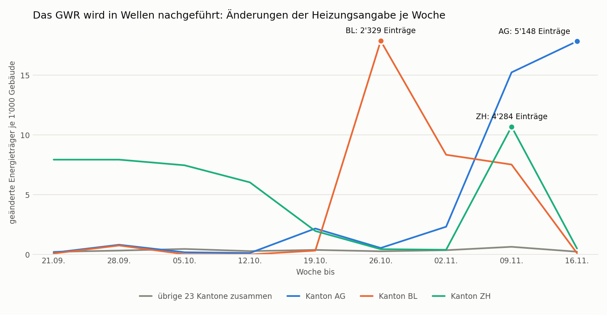
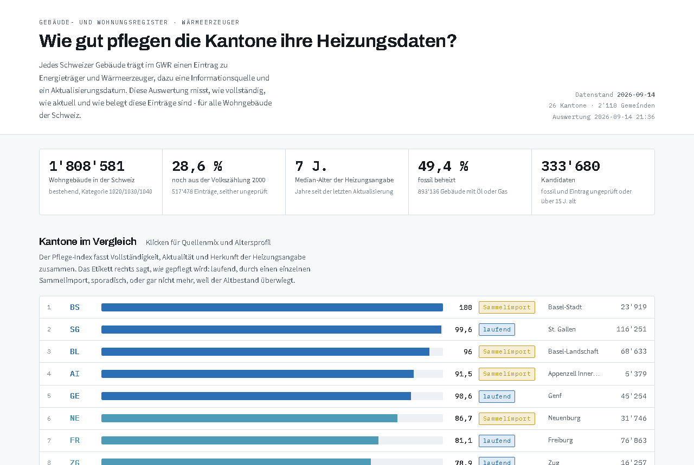
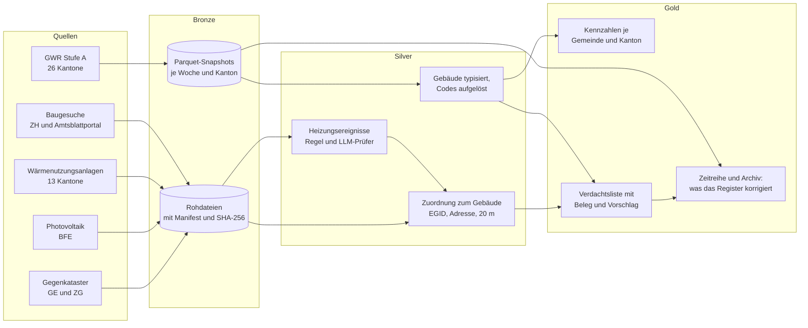

# GWR-Heizungscheck

[](https://github.com/Eroxyone/gwr-heizungscheck/actions/workflows/ci.yml)
[](requirements.txt)
[](LICENSE)

**Lassen sich veraltete Heizungsangaben im eidgenössischen Gebäude- und Wohnungsregister
(GWR) aus offenen Daten erkennen?** Eine Validierungsstudie, September bis November 2026.
Antwort: Ja, mit messbarer Trefferquote. Die wöchentlichen Abzüge des Registers zeigen
zugleich, dass mehrere Kantone gerade selbst nachführen.

**Ergebnisse, Dashboard und alle Berichte als Website:
[eroxyone.github.io/gwr-heizungscheck](https://eroxyone.github.io/gwr-heizungscheck/)**

Pipeline über 3,17 Mio Gebäude in allen 26 Kantonen, 13 kantonale Anlagenregister,
Baugesuche aus dem Amtsblattportal und dem Kanton Zürich, Photovoltaikanlagen des BFE.
Python und DuckDB, Bronze/Silver/Gold, wöchentliche Snapshot-Zeitreihe, 85 Prüfungen auf den
echten Daten, 128 Tests auf synthetischen Daten.

**Status:** abgeschlossen. Die Zeitreihe reicht bis zum 16.11.2026, das Repo wird nicht
aktiv weiterentwickelt. Fragen und Hinweise gern als Issue.

> **In English:** A validation study on Switzerland's Federal Register of Buildings and
> Dwellings (GWR): can outdated heating entries be detected from open data alone? A DuckDB
> pipeline (bronze/silver/gold) over 3.17 million buildings in all 26 cantons joins the
> register with 13 cantonal geothermal registries, building permit notices and solar
> installations, and takes weekly snapshots to measure how fast the register is corrected
> anyway. Where the evidence is newer than the register entry, 81 % of the flagged entries
> were wrong (63 of 78 checkable cases, one canton). The documentation is in German.



## Das Ergebnis in fünf Zahlen

| | |
|---|---|
| **28,6 %** | der Schweizer Wohngebäude tragen bei der Heizung noch die Volkszählung 2000 als Quelle. Das heisst ungeprüft, nicht falsch. |
| **16'025** | Wohngebäude sind fossil eingetragen, obwohl im Umkreis von 20 Metern eine Erdwärmesonde oder eine andere Wärmenutzungsanlage liegt und kein Gebäude dort eine Wärmepumpe ausweist (Stand September 2026, Kantone mit offenem Anlagenregister). Die Verdachtsliste zählt enger: nur Anlagen, die genau einem Gebäude zugeordnet sind. |
| **80,8 %** | der Verdachtsfälle treffen zu, wenn der Beleg jünger ist als der Registereintrag (63 von 78, Vertrauensbereich 71 bis 88 %). Liegt der Beleg vor dem Eintrag: 13,3 %, kaum über der Grundrate von 8,8 %. Gemessen am Öltankkataster eines einzigen Kantons (Zug). |
| **682 von 697** | Fällen der Liste vom 14.09.2026, die das Register bis zum 16.11.2026 korrigierte, erhielten den vorgeschlagenen Energieträger (Zürich: 645 von 650). Vorschlag und Korrektur stützen sich in Zürich auf dasselbe kantonale Sondenregister: Die Zahl belegt Übereinstimmung, keine unabhängige Trefferquote. |
| **2'000 bis 5'000 pro Woche** | Energieträger ändert ein Kanton, wenn er nachführt: Zürich 4'284 Anfang November, Aargau 5'148 Mitte November, Basel-Landschaft 2'329 Ende Oktober. Die übrigen 23 Kantone bewegen zusammen weniger als einen Eintrag je 1'000 Gebäude und Woche. |

## Was die Studie zeigt

**Technisch funktioniert es.** Aus GWR Stufe A, kantonalen Wärmenutzungsregistern, Baugesuchen
und Solaranlagen entsteht je Gebäude ein Beleg mit Datum, Referenz und Korrekturvorschlag. Die
Zuordnung einer Anlage zum Gebäude läuft über amtliche EGID, Adresse oder einen
20-Meter-Umkreis mit Eindeutigkeitsfilter.

**Das trennende Merkmal ist die Reihenfolge.** Ein Beleg, der nach dem letzten Registereintrag
entstand, zeigt an, dass seither niemand mehr ins Register geschaut hat. Ein Beleg davor
bedeutet, dass jemand nach der Bohrung den Eintrag bearbeitet und trotzdem Öl bestätigt hat.
Faktor 6 zwischen den beiden Gruppen.

**Die Kantone führen selbst nach.** In neun Wochen stellte der Kanton Zürich 2'720
Wohngebäude von fossil auf nicht fossil um, Gemeinde für Gemeinde; 650 davon standen auf der
Liste dieser Studie (24 %). Die übrigen drei Viertel erreicht sie nicht, weil der Kanton zu
jeder Sonde Datum und Gebäudebezug kennt und die offenen Daten nur Koordinate und Laufnummer
hergeben. Wo ein Kanton eigene Vollzugsdaten einsetzt, braucht es keine Vorauswahl von aussen.

**Wofür das Repo taugt:** als Methode für Kantone und Gemeinden ohne eigene Vollzugsdaten,
als Messinstrument dafür, wie viel sich im GWR tatsächlich bewegt, und als Vorlage für
ähnliche Abgleiche zwischen Registern und Geodaten.

## Grenzen

- **Ein Kanton als Massstab.** Die 80,8 % stammen aus Zug. Von 144 Zuger Fällen liessen sich
  79 prüfen, Gasheizungen gar nicht.
- **Zuordnung über Koordinaten.** Der 20-Meter-Umkreis enthält das richtige Gebäude bei
  73,8 % der Anlagen, das nächstgelegene Gebäude ist nur bei 64,7 % das richtige (gemessen
  an den amtlichen EGID des Kantons Zug).
- **Textauswertung nicht unabhängig geprüft.** Die Kaskade aus Stichwortregel und
  Sprachmodell erreicht 98,7 % Precision (78 von 79), gemessen an 150 Texten, die ein
  Sprachmodell gelabelt hat und an denen auch die Anweisung für das prüfende Modell
  entwickelt wurde. Eine frische, von einer Person gelabelte Stichprobe fehlt.
- **Keine Prüfung vor Ort.** Keine Gemeinde hat eine Stichprobe am Gebäude kontrolliert.

## Was ich anders machen würde

- **Zuerst die Zeitreihe, dann die Liste.** Wenige Wochen Snapshots haben mehr über den Nutzen
  der Methode gesagt als drei Wochen Listen bauen. Wer misst, wie schnell ein Register gepflegt
  wird, weiss, wo eine Vorauswahl überhaupt gebraucht wird.
- **Früher mit echten Korrekturen messen statt mit Katastern.** Der Zuger Tankkataster war ein
  Behelf; der Vergleich zweier Registerstände ist das ehrlichere Label und kostet nichts.
- **Metadaten nie als Qualitätsmass nehmen.** "Quelle Volkszählung 2000" heisst ungeprüft, nicht
  falsch. Die Stadt Zürich hat null solche Einträge und trotzdem bei zwei Dritteln der
  Heizungs-Baugesuche keine Nachführung.
- **Gold-Layer an den Snapshot koppeln, von Anfang an.** Zwei Wochen lang führte die Liste
  240 Fälle, die das Register schon korrigiert hatte, weil der Wochenlauf nur den Silver-Layer
  neu rechnete. Jetzt archiviert jeder Lauf die Liste je Stand und misst, was seither geschah.

## Berichte

[](https://eroxyone.github.io/gwr-heizungscheck/reports/dashboard.html)

Die [Website](https://eroxyone.github.io/gwr-heizungscheck/) zeigt alle Berichte gerendert,
dazu das interaktive Dashboard. Die Quellen liegen hier:

| Was | Wo |
|---|---|
| Befunde im Detail, mit Zahlen und Grenzen | [docs/befunde.md](docs/befunde.md) |
| Zeitreihe: Bewegung im Register je Woche, Korrekturen der Listenfälle | [reports/zeitreihe.md](reports/zeitreihe.md) |
| Belegwirkung: was ein Beleg wert ist, je Belegart und Stufe | [reports/belegwirkung.md](reports/belegwirkung.md) |
| Kantonsvergleich: Pflege-Index, Pflegemuster, Rangfolge | [reports/kantonsvergleich.md](reports/kantonsvergleich.md) |
| Genauigkeit der Zuordnung, gegen die amtlichen EGID des Kantons Zug | [reports/zuordnung_zg.md](reports/zuordnung_zg.md) |
| Auswertung der Baugesuchstexte: Stichwortregel und Sprachmodell | [reports/extraktion_evaluation.md](reports/extraktion_evaluation.md) |
| Detailauswertung Zürich: Baugesuche gegen Registerstand | [reports/report.md](reports/report.md) |
| Methode, Datenquellen, Lizenzlage | [docs/methode.md](docs/methode.md), [docs/datenquellen.md](docs/datenquellen.md), [reports/lizenzen.md](reports/lizenzen.md) |

Weitere Berichte (Quellenmatrix, Quellenvergleich, die Vorstufen der Messung) stehen in
`reports/`. Gebäudegenaue Listen sind nicht Teil dieses Repositories;
`python src/pruefliste.py --kanton ZH` erzeugt sie lokal als Arbeitsmappe.

## Loslegen

Voraussetzung: Python 3.11 oder neuer. Alles läuft lokal, es braucht weder einen Dienst noch
einen Zugang.

**Der schweizweite Strang** braucht nur das GWR und steht in wenigen Minuten:

```bash
pip install -r requirements.txt
python src/ingest.py            # alle 26 Kantone laden, rund 910 MB
python src/pipeline.py ch       # Silver- und Gold-Layer rechnen
python src/checks.py            # Datenqualitätsprüfungen
python src/export_dashboard.py  # Daten für reports/dashboard.html
```

Zum Ausprobieren reicht ein Kanton: `python src/ingest.py AI`, danach
`python src/pipeline.py ch`. Am selben Tag lädt `ingest.py` einen schon vorhandenen Kanton
nicht noch einmal; an jedem späteren Tag entsteht ein neuer Snapshot-Stand. `checks.py`
rechnet mit der ganzen Schweiz: Mit einem einzelnen Kanton schlagen die vier
Plausibilitätsprüfungen zum Gesamtbestand an.

**Der volle Lauf** holt zusätzlich die Belege: Baugesuche, Solaranlagen und die Anlagenregister
von 13 Kantonen. Daraus entstehen Verdachtsliste, Kantonsvergleich und Detailreport.

```bash
python src/download.py          # 30 Quellen, rund 300 MB; wiederholt gescheiterte Abrufe
python src/build_db.py          # Bronze-Tabellen für den Zürcher Detailstrang
python src/pipeline.py alle     # beide Stränge, rund zehn Minuten
python src/checks.py            # jetzt alle 85 Prüfungen
python src/report_ch.py         # Kantonsvergleich
python src/report.py            # Detailreport Zürich
```

Die Quellen sind lebende Register. Ein Lauf von heute rechnet auf dem Stand von heute und
liefert andere Zahlen als die Berichte in `reports/`, die den Stand der Studie festhalten.
Einige der 85 Prüfungen sind bewusst auf diesen Stand geeicht; auf neueren Daten zeigen sie
an, was sich seither bewegt hat. Die Berichtsskripte überschreiben die Fassungen in
`reports/`; `git checkout -- reports` holt sie zurück. Offene Quellen bleiben zudem nicht
immer offen: Am 22.11.2026 verlangte der Geodienst von St. Gallen und Appenzell
Innerrhoden eine Anmeldung. `download.py` meldet solche Ausfälle, und die Pipeline rechnet
mit den übrigen Kantonen weiter ([docs/datenquellen.md](docs/datenquellen.md)).

### Im Container

```bash
docker build -t gwr-heizungscheck .
docker run --rm gwr-heizungscheck                                         # Tests
docker run --rm -v gwr-daten:/data gwr-heizungscheck src/ingest.py
docker run --rm -v gwr-daten:/data gwr-heizungscheck src/pipeline.py ch
```

Rohdaten, Snapshots und Datenbank liegen auf dem Volume, nicht im Image. Berichte schreibt
der Container nach `/app/reports`; wer sie behalten will, bindet den Ordner ein
(`-v "$PWD/reports:/app/reports"`). Ohne Container legt die Umgebungsvariable `GWR_DATA_DIR`
das Datenverzeichnis fest.

### Tests, Lint und Website

```bash
pip install -r requirements-dev.txt
pytest                          # 128 Tests, rund 20 Sekunden, ohne Rohdaten
ruff check .
python scripts/build_site.py    # Website nach _site/, prüft dabei alle Verweise
```

## Architektur

Bronze/Silver/Gold in DuckDB. Die Fachlogik steht in SQL, je Schritt eine Datei; Python lädt
die Quellen, führt die Schritte in der richtigen Reihenfolge aus und erzeugt die Berichte.



```
src/                      Python: Ingest, Steuerung, Berichte, Evaluation
  config.py               Pfade, Kantone, Quellen und ihre Lizenzen an einem Ort
  ingest.py               Bronze: GWR je Kanton laden, als Parquet-Snapshot ablegen
  download.py             Bronze: Baugesuche ZH, Solaranlagen, kantonale Register
  ingest_baugesuche.py    Bronze: Baugesuche aus dem Amtsblattportal
  pipeline.py             führt die SQL-Schritte in der richtigen Reihenfolge aus
  checks.py               85 Datenqualitäts- und Regressionsprüfungen auf den echten Daten
  extract_llm.py          LLM-Extraktion der Heizungsereignisse (Claude API oder Ollama)
  eval_*.py, report*.py   Messungen und Berichte
sql/                      die Fachlogik, 22 Schritte
  silver_*.sql            Gebäude, Adressen, Baugesuche bereinigen; Heizungsereignisse erkennen
  match.sql, zuordnung_anlagen.sql
                          Entity Resolution: Baugesuch und Anlage zum Gebäude
  gold.sql                Kennzahlen je Gemeinde und Kanton, Pflegemuster, Zeitreihe
  gold_verdacht.sql       Verdachtsliste, Archiv je Stand, Korrektur-Sicht
  test1.sql … test5.sql   die Auswertungen der Studie
tests/                    pytest: Pipeline gegen ein erfundenes Register, Regel gegen Gold-Set
site/, scripts/           Website (Startseite, Stylesheet, Bau), wöchentlicher Snapshot-Lauf
docs/, reports/           Methode, Datenquellen, erzeugte Berichte
data/labels/              150 gelabelte Baugesuchstexte, im Git
data/raw/, data/snapshots/, data/processed/
                          Rohdaten, Snapshot-Zeitreihe, DuckDB und Listen, nicht im Git
```

**Warum Snapshots.** Ein einzelner GWR-Stand zeigt nur, wie das Register heute aussieht. Die
interessantere Grösse ist die Bewegung, und die lässt sich nicht nachträglich beschaffen.
`ingest.py` legt deshalb bei jedem Lauf ein Parquet je Kanton ab, hive-partitioniert nach
`snapshot_date` und `kanton`, rund 60 MB für die ganze Schweiz. Der Gold-Layer wird aus dem
jüngsten Stand gerechnet; `gold_liste_archiv` hält fest, was je Stand auf der Liste stand, und
`v_gold_liste_korrigiert` zeigt, was das Register seither selbst korrigiert hat. Mehr dazu in
[docs/methode.md](docs/methode.md).

## Qualitätssicherung

| Ebene | Was sie prüft | Wann |
|---|---|---|
| `pytest`, 128 Tests | Die SQL-Schritte laufen unverändert über erfundene Register mit zwei Snapshot-Ständen: Silver und Gold des schweizweiten Strangs, die Zuordnung der Anlagen mit allen zehn Entscheidungen der Kaskade, die Verdachtsliste mit jeder Stufe, Archiv und Korrektur-Sicht. Jede erwartete Zahl lässt sich von Hand nachzählen. Dazu die Stichwortregel gegen 150 gelabelte Texte, die Inhaltsprüfung der Downloads, Anonymisierung, fehlende Quellen und der Bau der Website. Nicht abgedeckt: die Messungen gegen die Kataster von Genf und Zug und die Kalibrierung der Zürcher Laufnummer. | bei jedem Push in der CI, ohne Rohdaten, in rund 20 Sekunden |
| `python src/checks.py`, 85 Prüfungen | Behauptungen über die echten Daten: Schlüsseleindeutigkeit, Wertebereiche, Koordinaten innerhalb der Schweiz, Codelisten-Abdeckung, Konsistenz von Gemeinde- und Kantonssummen, Snapshot-Integrität, festgeschriebene Regressionswerte. | nach jedem Pipelinelauf; letzter Stand in [reports/checks_baseline.txt](reports/checks_baseline.txt) |
| Messung gegen Fremddaten | Zuordnung gegen die amtlichen EGID des Kantons Zug, Verdacht gegen die Kataster von Genf und Zug, Liste gegen die Korrekturen, die das Register später selbst vornahm. | je Bericht |

Was die Prüfungen tatsächlich gefunden haben:

- 11 GWR-Einträge tragen am 16.11.2026 ein Aktualisierungsdatum in der Zukunft, der späteste
  im Dezember 2027. Erfassungsfehler der Quelle, nicht korrigierbar, aber überwacht.
- Der Verdachts-Layer hatte einen Logikfehler: 26 Gebäude kamen auf die Liste, obwohl ihr
  Baugesuch bereits nachgeführt war. Der Filter prüfte die Existenz eines Baugesuchs statt
  dessen Nachführungsstatus.
- Die Vergleichs-View der Zeitreihe zählte Zugänge nicht: Neue EGID landeten im FULL JOIN in
  einer NULL-Gruppe statt beim Kanton. Gefunden von einem Test mit synthetischem Vor-Snapshot,
  Wochen bevor der zweite echte Snapshot vorlag.
- Das Archiv der Liste prüfte nur, ob ein Stand schon vorlag, nicht für welchen Kanton. Ein
  Kanton, dessen Snapshot erst in einem späteren Lauf nachkam, hätte im Archiv dieses Stands
  gefehlt. In den echten Daten nie eingetreten; gefunden von einem Test, der genau das
  nachstellt.
- Der Adress-Schritt brach mit einem internen DuckDB-Fehler ab, sobald genau eine
  Snapshot-Datei vorlag, also bei jedem, der zum Ausprobieren nur einen Kanton lädt. Mit 26
  Kantonen fiel das nie auf; gefunden hat es der erste Lauf über das erfundene Register.

## Verwandte Arbeiten

- **Kanton Zürich.** Das AWEL beschreibt in der Zürcher Umweltpraxis Nr. 109 vom Dezember
  2024, wie Gemeinden die Heizungsdaten im GWR nachführen
  ([ZUP 109](https://www.zh.ch/de/umwelt-tiere/umweltschutz/umweltpraxis/definitionsseite/2024/zup-nr-109/heizungsdaten-im-gebaeude--und-wohnungsregister-nachfuehren.html)).
  Die Zeitreihe dieser Studie zeigt die Umsetzung im Herbst 2026.
- **Kanton Luzern.** Im Projekt "GWR-Verbesserung" hat die Dienststelle Umwelt und Energie
  kantonale Datensätze mit dem GWR abgeglichen und den Gemeinden Prüflisten bereitgestellt;
  Eigentümerinnen und Eigentümer können Korrekturen über eine Webkarte melden
  ([Energiedaten und Tools](https://uwe.lu.ch/themen/energie/daten_energie)). Welche der dort
  verwendeten Quellen offen verfügbar sind, steht in
  [reports/quellenvergleich.md](reports/quellenvergleich.md).
- **Hochschule Luzern und geoimpact.** Ein 2022 vorgestelltes Modell des Kompetenzzentrums
  Thermal Energy Storage lokalisiert fossile Heizungen mit maschinellem Lernen, trainiert auf
  den öffentlichen GWR-Daten
  ([Medienmitteilung](https://www.hslu.ch/en/lucerne-university-of-applied-sciences-and-arts/about-us/media/medienmitteilungen/2022/10/12/ki-vs-oelheizungen)).
  Der Ansatz hier ist ein anderer: kein Modell über Gebäudemerkmale, sondern ein Abgleich mit
  datierten Belegen je Gebäude.

## Zur Entstehung

- **Kurze Historie.** Die Arbeitshistorie enthält gebäudegenaue Zwischenstände und bleibt
  deshalb privat. Diese Fassung ist ein bereinigter Export.
- **KI-Einsatz.** Code, SQL und Berichtstexte sind zu einem grossen Teil im Dialog mit einem
  KI-Codierassistenten (Claude Code) entstanden, die Durchsichten vor der Veröffentlichung
  ebenfalls.
- **Labels.** Die 150 Baugesuchstexte des Gold-Sets hat ein Sprachmodell gelabelt; eine
  Zweitprüfung durch eine Person ist nicht dokumentiert
  ([data/labels/README.md](data/labels/README.md)).

## Datenquellen

Alle Quellen sind offen zugänglich. `data/raw/manifest.json` und
`data/snapshots/ingest_manifest.jsonl` halten zu jedem Bezug URL, Grösse, SHA-256 und
Zeitpunkt fest.

| Quelle | Herausgeber | Wofür |
|---|---|---|
| GWR, öffentliche Daten Stufe A | Bundesamt für Statistik | Registerstand aller Gebäude, wöchentlicher Snapshot |
| Baugesuche im Kanton Zürich | Statistisches Amt des Kantons Zürich | Heizungsereignisse mit Parzellengeometrie |
| Baugesuche schweizweit | Amtsblattportal, 13 Kantone | Heizungsereignisse ausserhalb Zürichs |
| Wärmenutzungsanlagen | 13 kantonale Geodienste, jeder in eigenem Format | Beleg direkt am Gebäude, in neun Kantonen datiert |
| Elektrizitätsproduktionsanlagen | Bundesamt für Energie | Photovoltaik als schwaches Indiz, schweizweit |
| Feuerungskataster Genf, Tankkataster Zug | Kantone Genf und Zug | Vergleichsdaten: Läuft die fossile Heizung noch? |

Adressen, Layer, Abruffallen und die geprüften, aber verworfenen Quellen stehen in
[docs/datenquellen.md](docs/datenquellen.md), die Lizenzlage in
[reports/lizenzen.md](reports/lizenzen.md).

## Regeln in diesem Repo

- Rohdaten und Snapshots kommen nie ins Git.
- Gebäudegenaue Ergebnisse werden nicht veröffentlicht. Verdachts- und Prüflisten entstehen
  unter `data/processed/` und damit ausserhalb des Git.
- Keine Personendaten in Listen und Berichten. Namen im Projektbeschrieb werden beim
  Einlesen entfernt. Schaffhausen und Wallis nennen die Bauherrschaft im Titel der
  Publikation; der Titel liegt roh im lokalen Abzug und wird im Silver-Layer bereinigt,
  bevor ein Text weiterverwendet wird.
- Codes und Kataloge stammen aus den Originaldateien, nicht aus dem Gedächtnis.
- Zahlen in den Berichtstabellen kommen aus der Pipeline. Erläuternde Sätze in den
  Berichtsvorlagen nennen einzelne Messwerte fest und sind mit ihrem Stand zu lesen.

## Lizenz

Code unter der [MIT-Lizenz](LICENSE), Berichte und Texte unter CC BY 4.0. Die Quelldaten
gehören ihren Herausgebern; was davon weiterverwendet werden darf, steht in
[reports/lizenzen.md](reports/lizenzen.md). Wer die Arbeit zitieren möchte, findet die
Angaben in [CITATION.cff](CITATION.cff).
