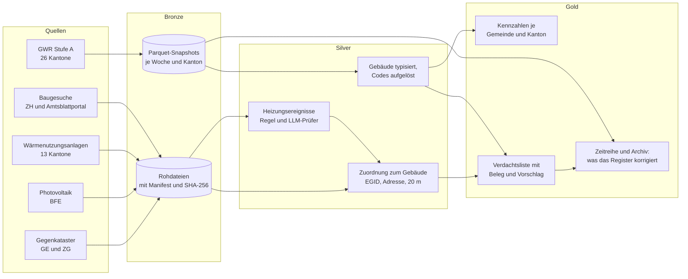

# GWR-Heizungscheck

[](https://github.com/Eroxyone/gwr-heizungscheck/actions/workflows/ci.yml)
[](requirements.txt)
[](LICENSE)

**Lassen sich veraltete Heizungsangaben im eidgenössischen Gebäude- und Wohnungsregister
(GWR) aus offenen Daten erkennen?** Eine Validierungsstudie, September bis November 2026.
Antwort: Ja, mit messbarer Trefferquote. Und die Snapshot-Zeitreihe zeigt zugleich, wie
schnell die Kantone selbst nachführen. Code und Berichte stehen frei zur Verfügung.

Pipeline über **3,17 Mio Gebäude in allen 26 Kantonen**, 13 kantonale Anlagenregister,
Baugesuche aus dem Amtsblattportal und dem Kanton Zürich, Photovoltaikanlagen des BFE.
Python und DuckDB, Bronze/Silver/Gold, wöchentliche Snapshot-Zeitreihe, 85 Prüfungen auf den
echten Daten, 39 Tests auf synthetischen Daten in der CI.

**Status:** abgeschlossen. Die Frage der Studie ist beantwortet, die Zeitreihe reicht bis zum
16.11.2026, das Repo wird nicht aktiv weiterentwickelt. Fragen und Hinweise gern als Issue.

> **In English:** A validation study on Switzerland's Federal Register of Buildings and
> Dwellings (GWR): can outdated heating entries be detected from open data alone? A DuckDB
> pipeline (bronze/silver/gold) over 3.17 million buildings in all 26 cantons joins the
> register with 13 cantonal geothermal registries, building permit notices and solar
> installations, and takes weekly snapshots to measure how fast the register is corrected
> anyway. Result: yes, within limits. Where the evidence is newer than the register entry,
> 81 % of the flagged entries were wrong (63 of 78 checkable cases, one canton), and of 697
> flagged entries that the authorities later corrected themselves, 682 received the energy
> source the pipeline had proposed. The documentation is in German.


## Das Ergebnis in fünf Zahlen

| | |
|---|---|
| **28,6 %** | aller Schweizer Wohngebäude tragen bei der Heizung noch die Volkszählung 2000 als Quelle. Der Eintrag ist seit 25 Jahren ungeprüft. |
| **16'025** | Wohngebäude sind fossil eingetragen, obwohl direkt daneben eine Erdwärmesonde oder eine andere Wärmenutzungsanlage bewilligt wurde. |
| **80,8 %** | der Verdachtsfälle treffen zu, wenn der Beleg jünger ist als der Registereintrag (63 von 78, Zuger Öltankkataster als Label). Liegt der Beleg vor dem Eintrag: 13,3 %, kaum über der Grundrate von 8,8 %. Die Reihenfolge trennt stärker als die Belegart. Gemessen in einem einzigen Kanton; von 144 Zuger Fällen liessen sich 79 prüfen. |
| **682 von 697** | Fälle der Liste vom 14.09.2026, die bis zum 16.11.2026 im Register korrigiert wurden, bekamen den vorgeschlagenen Energieträger. Allein im Kanton Zürich 645 von 650. Die erste Messung an echten Korrekturen statt an einem Kataster. |
| **2'000 bis 5'000 pro Woche** | Energieträger-Änderungen, wenn ein Kanton nachführt: Zürich rund 3'000 von Mitte September bis Mitte Oktober und 4'284 Anfang November, Aargau 4'398 und 5'148 im November, Basel-Landschaft 2'329 Ende Oktober. Die übrigen 23 Kantone bewegen zusammen weniger als einen Eintrag je 1'000 Gebäude und Woche. Das Register wird in Wellen gepflegt, nicht laufend. |

## Was die Studie beantwortet hat

**Technisch funktioniert es.** Aus GWR Stufe A, kantonalen Wärmenutzungsregistern, Baugesuchen
und Solaranlagen entsteht je Gebäude ein Beleg mit Datum, Referenz und Korrekturvorschlag. Die
Zuordnung Anlage zu Gebäude läuft über amtliche EGID, Adresse oder 20-Meter-Umkreis mit
Eindeutigkeitsfilter. Gemessen ist davon der reine Umkreis, gegen die amtlichen EGID des
Kantons Zug: Bei 73,8 % der Anlagen liegt das richtige Gebäude unter den Kandidaten, bei
64,7 % ist es das nächstgelegene. Die Stichwortregel für Baugesuche wurde durch ein
Sprachmodell als Prüfer ergänzt: 98,7 % Precision (78 von 79) an 150 Texten, deren Labels
ebenfalls von einem Sprachmodell stammen.

**Das trennende Merkmal ist die Reihenfolge.** Ein Beleg, der nach dem letzten Registereintrag
entstand, zeigt an, dass seither niemand mehr ins Register geschaut hat. Ein Beleg davor
bedeutet, dass jemand nach der Bohrung den Eintrag angefasst und trotzdem Öl bestätigt hat.
Faktor 6 zwischen den beiden Gruppen, gemessen in Zug und bestätigt an 650 Zürcher Korrekturen.

**Die Kantone führen selbst nach.** Die Snapshot-Zeitreihe zeigt, dass der Kanton Zürich
das Verfahren aus seinem eigenen Leitfaden (ZUP 109) flächendeckend umsetzt, Gemeinde für
Gemeinde. In neun Wochen wurden 2'720 Zürcher Wohngebäude von fossil auf nicht fossil
umgestellt; 650 davon standen auf der Liste (24 %). Die übrigen drei Viertel erreicht sie nicht, weil der Kanton zu jeder Sonde Datum und Gebäudebezug kennt
und die offenen Daten nur Koordinate und Laufnummer hergeben. Wo die Vollzugsdaten offen
wären, bräuchte es die Vorauswahl nicht.

**Wofür das Repo taugt:** als Methode für Kantone und Gemeinden ohne eigene Vollzugsdaten,
als Messinstrument dafür, wie viel sich im GWR tatsächlich bewegt, und als Vorlage für
ähnliche Abgleiche zwischen Registern und Geodaten.

## Was ich anders machen würde

- **Zuerst die Zeitreihe, dann die Liste.** Wenige Wochen Snapshots haben mehr über den Nutzen
  der Methode gesagt als drei Wochen Listen bauen. Wer misst, wie schnell ein Register gepflegt
  wird, weiss, wo eine Vorauswahl überhaupt gebraucht wird.
- **Früher mit echten Korrekturen messen statt mit Katastern.** Der Zuger Tankkataster war ein
  Behelf; der Vergleich zweier Registerstände ist das ehrlichere Label und kostet nichts.
- **Metadaten nie als Qualitätsmass nehmen.** "Quelle Volkszählung 2000" heisst ungeprüft, nicht
  falsch. Die Stadt Zürich hat null solche Einträge und trotzdem bei zwei Dritteln der
  Heizungs-Baugesuche keine Nachführung.
- **Gold-Layer an den Snapshot koppeln, von Anfang an.** Zwei Wochen lang führte die Liste
  240 Fälle, die das Register schon korrigiert hatte, weil der Wochenlauf nur den Silver-Layer
  neu rechnete. Jetzt archiviert jeder Lauf die Liste je Stand und misst, was seither geschah.

## Berichte

[](reports/dashboard.html)

| Was | Wo |
|---|---|
| **Befunde im Detail** - die acht Befunde mit Zahlen und Grenzen | [docs/befunde.md](docs/befunde.md) |
| **Zeitreihe** - Bewegung im Register je Woche, Korrekturen der Listenfälle | [reports/zeitreihe.md](reports/zeitreihe.md) |
| **Belegwirkung** - was ein Beleg wert ist, je Belegart und je Stufe gemessen | [reports/belegwirkung.md](reports/belegwirkung.md) |
| **Kantonsvergleich** - Pflege-Index, Pflegemuster, Rangliste | [reports/kantonsvergleich.md](reports/kantonsvergleich.md) |
| **Genauigkeit der Zuordnung** - gemessen gegen die amtlichen EGID des Kantons Zug | [reports/zuordnung_zg.md](reports/zuordnung_zg.md) |
| **Evaluation der Textextraktion** - Stichwortregel und Sprachmodell gegen Gold-Set | [reports/extraktion_evaluation.md](reports/extraktion_evaluation.md) |
| **Quellenmatrix** - welche Daten es je Kanton gibt und welche Prüftiefe daraus folgt | [reports/quellenmatrix.md](reports/quellenmatrix.md) |
| **Quellenvergleich** - was der Kanton Luzern in seinem Projekt verwendet hat und was offen fehlt | [reports/quellenvergleich.md](reports/quellenvergleich.md) |
| **Lizenzlage** - Nutzungsbedingungen je Quelle | [reports/lizenzen.md](reports/lizenzen.md) |
| **Detailauswertung Zürich** - Baugesuche gegen Registerstand, die vier ursprünglichen Tests | [reports/report.md](reports/report.md) |
| **Dashboard** - 26 Kantone, 2'110 Gemeinden, Stand 14.09.2026 | [reports/dashboard.html](reports/dashboard.html) |
| **Zwischenbericht** - der Stand vom 14.09.2026 auf einer Seite, vor Kalibrierung und Zeitreihe | [reports/befund.html](reports/befund.html) |
| **Vorstufe der Messung** - Verdacht gegen aktive Kessel in Genf und Zug; abgelöst durch die Belegwirkung | [reports/precision.md](reports/precision.md), [reports/groundtruth.md](reports/groundtruth.md) |

Die beiden HTML-Seiten zeigt GitHub als Quelltext; nach dem Klonen lassen sie sich direkt im
Browser öffnen. Die Methode im Einzelnen steht in [docs/methode.md](docs/methode.md), jede
Quelle mit Adresse und Eigenheiten in [docs/datenquellen.md](docs/datenquellen.md).

Gebäudegenaue Listen sind nicht Teil dieses Repositories; sie gehören zur jeweiligen Gemeinde.
`python src/pruefliste.py --kanton ZH` erzeugt sie lokal als Arbeitsmappe.

## Loslegen

Voraussetzung: Python 3.11 oder neuer. Alles läuft lokal, es braucht weder einen Dienst noch
einen Zugang.

**Der schweizweite Strang** braucht nur das GWR und steht in wenigen Minuten:

```bash
pip install -r requirements.txt
python src/ingest.py            # alle 26 Kantone laden, rund 910 MB
python src/pipeline.py ch       # Silver- und Gold-Layer rechnen
python src/checks.py            # Datenqualitätsprüfungen
python src/export_dashboard.py  # Daten für reports/dashboard.html
```

Zum Ausprobieren reicht ein Kanton: `python src/ingest.py AI`, danach `python src/pipeline.py ch`.
`ingest.py` überspringt Kantone, deren Stand schon vorliegt; `--force` erzwingt den Neubezug.
Sobald zwei Snapshot-Stände vorliegen, zeichnet `python src/plot_zeitreihe.py` die Bewegung
dazwischen.

**Der volle Lauf** holt zusätzlich die Belege: Baugesuche, Solaranlagen und die Anlagenregister
von 13 Kantonen. Daraus entstehen Verdachtsliste, Kantonsvergleich und Detailreport.

```bash
python src/download.py          # 30 Quellen, rund 300 MB; wiederholt gescheiterte Abrufe
python src/build_db.py          # Bronze-Tabellen für den Zürcher Detailstrang
python src/pipeline.py alle     # beide Stränge, rund zehn Minuten
python src/checks.py            # jetzt alle 85 Prüfungen
python src/report_ch.py         # Kantonsvergleich
python src/report.py            # Detailreport Zürich
```

Offene Quellen bleiben nicht immer offen: Am 22.11.2026 verlangte der Geodienst von
St. Gallen und Appenzell Innerrhoden eine Anmeldung, im September noch nicht. `download.py` meldet solche Ausfälle,
und die Pipeline rechnet mit den übrigen Kantonen weiter
([docs/datenquellen.md](docs/datenquellen.md)).

Die Quellen sind lebende Register. Ein Lauf von heute rechnet auf dem Stand von heute und
liefert deshalb andere Zahlen als die Berichte in `reports/`, die den Stand der Studie
festhalten. Von den 85 Prüfungen sind einige bewusst auf diesen Stand geeicht
(Regressionswerte der Zürcher Detailauswertung, Bandbreiten gemessener Anteile); auf neueren
Daten zeigen sie an, was sich seither im Register bewegt hat. Die Berichtsskripte schreiben
nach `reports/` und überschreiben dort die Fassungen der Studie; `git checkout -- reports`
holt sie zurück. Die Baugesuche aus dem Amtsblattportal (`python src/ingest_baugesuche.py`)
sind optional und brauchen Stunden.

### Im Container

Dieselbe Umgebung ohne lokale Python-Installation. Rohdaten, Snapshots und Datenbank liegen
auf einem Volume, nicht im Image.

```bash
docker build -t gwr-heizungscheck .
docker run --rm gwr-heizungscheck                                         # Tests
docker run --rm -v gwr-daten:/data gwr-heizungscheck src/ingest.py
docker run --rm -v gwr-daten:/data gwr-heizungscheck src/pipeline.py ch
```

Berichte schreibt der Container nach `/app/reports`; wer sie behalten will, bindet den Ordner
ein (`-v "$PWD/reports:/app/reports"`). Ohne Container legt die Umgebungsvariable
`GWR_DATA_DIR` das Datenverzeichnis fest; Standard ist `data/` im Repo.

### Tests und Lint

```bash
pip install -r requirements-dev.txt
pytest          # 39 Tests, wenige Sekunden, ohne Rohdaten
ruff check .
```

## Architektur

Bronze/Silver/Gold in DuckDB. Die Fachlogik steht in SQL, je Schritt eine Datei; Python lädt
die Quellen, führt die Schritte in der richtigen Reihenfolge aus und erzeugt die Berichte.



```
src/                      Python: Ingest, Steuerung, Berichte, Evaluation
  config.py               Pfade, Kantone, Quellen und ihre Lizenzen an einem Ort
  ingest.py               Bronze: GWR je Kanton laden, als Parquet-Snapshot ablegen
  download.py             Bronze: Baugesuche ZH, Solaranlagen, kantonale Register
  ingest_baugesuche.py    Bronze: Baugesuche aus dem Amtsblattportal, Beschrieb beim Einlesen anonymisiert
  build_db.py             Bronze: Rohdateien für den ZH-Strang nach DuckDB
  pipeline.py             führt die SQL-Schritte in der richtigen Reihenfolge aus
  checks.py               85 Datenqualitäts- und Regressionsprüfungen auf den echten Daten
  extract_llm.py          LLM-Extraktion der Heizungsereignisse (Claude API oder Ollama)
  eval_*.py               Messungen: Textextraktion gegen Gold-Set, Zuordnung gegen amtliche EGID
  report*.py, export_*.py erzeugen die Berichte und die Daten für Dashboard und Befund-Seite
  plot_zeitreihe.py       Zeitreihe als Diagramm und Tabelle
  pruefliste.py           Arbeitsmappe je Kanton oder Gemeinde (Ausgabe ausserhalb des Git)

sql/                      die Fachlogik
  silver_ch.sql           Silver: Gebäude CH typisiert, Codes aufgelöst, Klassen
  silver_adressen.sql     Silver: Adressen normalisiert
  silver_baugesuche*.sql  Silver: Baugesuche normalisiert, Heizungsereignisse erkannt
  silver_llm.sql          Silver: LLM-Prüfung der Treffer, Kaskade Regel und Modell
  match.sql               Entity Resolution: Baugesuch zu EGID, zwei unabhängige Wege
  zuordnung_anlagen.sql   Entity Resolution: Anlage zu EGID
  gold.sql                Gold: Kennzahlen je Gemeinde und Kanton, Pflegemuster, Zeitreihe
  gold_verdacht.sql       Gold: Verdachtsscore je Gebäude, Liste, Archiv, Korrektur-Sicht
  test1.sql … test5.sql   die Auswertungen der Studie (Test 5 und 6 stehen in test5.sql)
  gegenbeleg_*.sql, groundtruth_*.sql, precision_ge.sql, belegwirkung.sql
                          Messung gegen die Kataster von Genf und Zug

tests/                    pytest: Pipeline gegen ein erfundenes Register, Regel gegen Gold-Set
docs/                     Methode und Datenquellen im Einzelnen
reports/                  erzeugte Berichte, Dashboard, Diagramm
data/labels/              150 gelabelte Baugesuchstexte, im Git
data/raw/                 Rohdaten, nicht im Git
data/snapshots/           die Snapshot-Zeitreihe, nicht im Git
data/processed/           DuckDB und gebäudegenaue Listen, nicht im Git
scripts/snapshot.ps1      wöchentlicher Snapshot-Lauf für den Windows-Taskplaner
Dockerfile                dieselbe Umgebung als Container
```

**Warum Snapshots.** Ein einzelner GWR-Stand zeigt nur, wie das Register heute aussieht. Die
interessantere Grösse ist die Bewegung, und die lässt sich nicht nachträglich beschaffen.
`ingest.py` legt deshalb bei jedem Lauf ein Parquet je Kanton ab, hive-partitioniert nach
`snapshot_date` und `kanton`, rund 60 MB für die ganze Schweiz. Der Gold-Layer wird aus dem
jüngsten Stand gerechnet; `gold_liste_archiv` hält fest, was je Stand auf der Liste stand, und
`v_gold_liste_korrigiert` zeigt, was das Register seither selbst korrigiert hat. Mehr dazu in
[docs/methode.md](docs/methode.md).

## Qualitätssicherung

Drei Ebenen, von billig bis aufwendig:

| Ebene | Was sie prüft | Wann |
|---|---|---|
| `pytest`, 39 Tests | Vier der 22 SQL-Schritte (Silver und Gold des schweizweiten Strangs, die Stichwortregel) laufen unverändert über ein erfundenes Register mit zwei Snapshot-Ständen und über 150 gelabelte Baugesuchstexte; jede erwartete Zahl lässt sich von Hand nachzählen. Dazu Formatierung, Anonymisierung und der Umgang mit fehlenden Quellen. | bei jedem Push in der CI, ohne Rohdaten, in Sekunden |
| `python src/checks.py`, 85 Prüfungen | Behauptungen über die echten Daten, darunter alles zum Verdachts-Layer, den die Tests nicht abdecken: Schlüsseleindeutigkeit, Wertebereiche, Koordinaten innerhalb der Schweiz, Codelisten-Abdeckung, Konsistenz von Gemeinde- und Kantonssummen, Snapshot-Integrität, festgeschriebene Regressionswerte. | nach jedem Pipelinelauf; letzter Stand in [reports/checks_baseline.txt](reports/checks_baseline.txt) |
| Messung gegen Fremddaten | Zuordnung gegen die amtlichen EGID des Kantons Zug, Verdacht gegen die Kataster von Genf und Zug, Liste gegen die Korrekturen, die das Register später selbst vornahm. | je Bericht |

Was die Prüfungen tatsächlich gefunden haben:

- 9 GWR-Einträge tragen ein Aktualisierungsdatum in der Zukunft, einer davon im Juni 2027.
  Erfassungsfehler der Quelle, nicht korrigierbar, aber überwacht.
- Der Verdachts-Layer hatte einen Logikfehler: 26 Gebäude kamen auf die Liste, obwohl ihr
  Baugesuch bereits nachgeführt war. Der Filter prüfte die Existenz eines Baugesuchs statt
  dessen Nachführungsstatus. Gefunden vom Check "Verdachtsfall hat immer mindestens einen
  echten Beleg".
- Die Vergleichs-View der Zeitreihe zählte Zugänge nicht: Neue EGID landeten im FULL JOIN in
  einer NULL-Gruppe statt beim Kanton. Gefunden von einem Test mit synthetischem Vor-Snapshot,
  Wochen bevor der zweite echte Snapshot vorlag.
- Der Adress-Schritt brach mit einem internen DuckDB-Fehler ab, sobald genau eine
  Snapshot-Datei vorlag, also bei jedem, der zum Ausprobieren nur einen Kanton lädt. Mit 26
  Kantonen fiel das nie auf; gefunden hat es der erste Lauf über das erfundene Register.

## Zur Entstehung

- **Kurze Historie.** Die Arbeitshistorie enthält Namen von Ansprechpersonen und
  gebäudegenaue Zwischenstände und bleibt deshalb privat. Diese Fassung ist ein bereinigter
  Export und beginnt mit einem einzigen grossen Commit.
- **KI-Einsatz.** Code, SQL und Berichtstexte sind zu einem grossen Teil im Dialog mit einem
  KI-Codierassistenten (Claude Code) entstanden. Wo in Kommentaren oder Berichten von einer
  unabhängigen Durchsicht die Rede ist, waren das Prüfläufe weiterer Modelle mit frischem
  Kontext, keine externen Fachgutachten.
- **Labels.** Die 150 Baugesuchstexte des Gold-Sets hat ein Sprachmodell gelabelt, nach
  Durchsicht des ganzen Texts; eine Zweitprüfung durch eine Person ist nicht dokumentiert
  ([data/labels/README.md](data/labels/README.md)). Die Precision der Textextraktion ist
  damit ein Modell gegen ein anderes gemessen.
- **Was ungetestet bleibt.** Der Verdachts-Layer (`sql/gold_verdacht.sql`) und die Zuordnung
  der Anlagen haben keinen automatischen Test auf synthetischen Daten; sie sind nur über die
  Prüfungen auf den echten Daten und die Messung gegen Fremddaten abgesichert.

## Datenquellen

Alle Quellen sind offene Daten. `data/raw/manifest.json` und
`data/snapshots/ingest_manifest.jsonl` halten zu jedem Bezug URL, Grösse, SHA-256 und
Zeitpunkt fest.

| Quelle | Herausgeber | Wofür |
|---|---|---|
| GWR, öffentliche Daten Stufe A | Bundesamt für Statistik | Registerstand aller Gebäude, wöchentlicher Snapshot |
| Baugesuche im Kanton Zürich | Statistisches Amt des Kantons Zürich | Heizungsereignisse mit Parzellengeometrie |
| Baugesuche schweizweit | Amtsblattportal, 13 Kantone | Heizungsereignisse ausserhalb Zürichs |
| Wärmenutzungsanlagen | 13 kantonale Geodienste, jeder in eigenem Format | Beleg direkt am Gebäude, in neun Kantonen datiert |
| Elektrizitätsproduktionsanlagen | Bundesamt für Energie | Photovoltaik als schwaches Indiz, schweizweit |
| Feuerungskataster Genf, Tankkataster Zug | Kantone Genf und Zug | Labels: Läuft die fossile Heizung noch? |

Adressen, Layer, Abruffallen und die geprüften, aber verworfenen Quellen stehen in
[docs/datenquellen.md](docs/datenquellen.md), die Lizenzlage in
[reports/lizenzen.md](reports/lizenzen.md).

## Regeln in diesem Repo

- Rohdaten und Snapshots kommen nie ins Git.
- Gebäudegenaue Ergebnisse werden nicht veröffentlicht. Verdachts- und Prüflisten entstehen
  unter `data/processed/` und damit ausserhalb des Git.
- Keine Personendaten in Listen und Berichten. Namen im Projektbeschrieb werden beim
  Einlesen entfernt. Schaffhausen und Wallis nennen die Bauherrschaft im Titel der
  Publikation; der Titel liegt roh im lokalen Abzug und wird im Silver-Layer bereinigt,
  bevor ein Text weiterverwendet wird.
- Codes und Kataloge stammen aus den Originaldateien, nicht aus dem Gedächtnis.
- Annahmen und Unsicherheiten gehören in den Report, nicht in eine Fussnote.
- Zahlen in den Berichtstabellen kommen aus der Pipeline. Erläuternde Sätze in den
  Berichtsvorlagen nennen einzelne Messwerte fest und sind mit ihrem Stand zu lesen.

## Lizenz

Code unter der [MIT-Lizenz](LICENSE), Berichte und Texte unter CC BY 4.0. Die Quelldaten
gehören ihren Herausgebern; was davon weiterverwendet werden darf, steht in
[reports/lizenzen.md](reports/lizenzen.md). Wer die Arbeit zitieren möchte, findet die
Angaben in [CITATION.cff](CITATION.cff).
