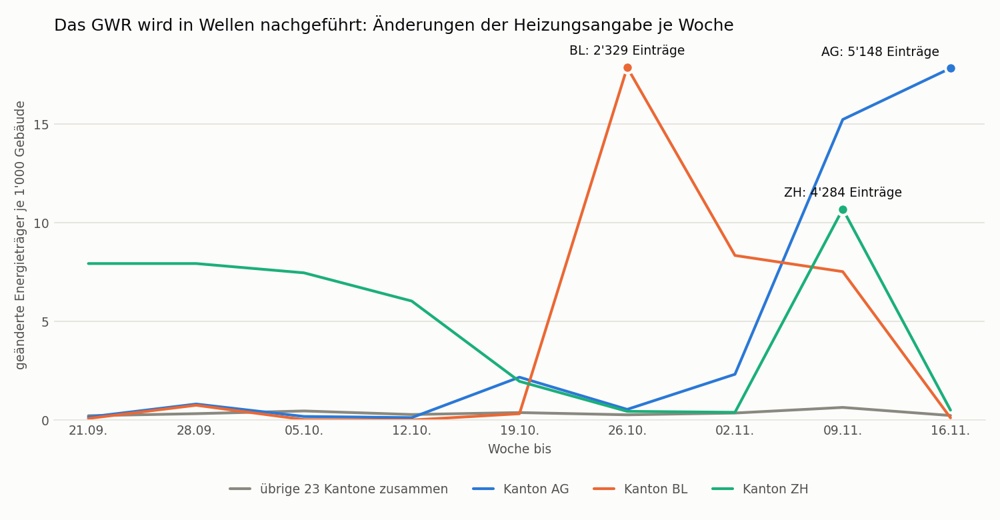

# Zeitreihe: Bewegung im Register je Woche

Stand 16.11.2026. Gezählt wird je Kanton und Woche, wie viele Einträge des Registers einen anderen Energieträger (GENH1) tragen als im Snapshot der Vorwoche, alle Gebäude unabhängig von ihrem Status (`v_gold_veraenderung`).

3 Kantone ändern im Mittel mindestens einen Eintrag je 1'000 Gebäude und Woche (ZH, AG, BL), die übrigen 23 bleiben darunter. Die Tabelle ist nach dieser mittleren Rate geordnet; die Wochenspalten zeigen, dass die hohen Werte aus einzelnen Wellen stammen.

| Kanton | je 1'000 und Woche | Gebäude | bis 21.09. | bis 28.09. | bis 05.10. | bis 12.10. | bis 19.10. | bis 26.10. | bis 02.11. | bis 09.11. | bis 16.11. |
|---|---:|---:|---:|---:|---:|---:|---:|---:|---:|---:|---:|
| ZH | 4,81 | 400'665 | 3'174 | 3'175 | 2'987 | 2'412 | 786 | 178 | 158 | 4'284 | 199 |
| AG | 4,37 | 288'730 | 44 | 234 | 51 | 34 | 625 | 155 | 670 | 4'398 | 5'148 |
| BL | 3,89 | 130'436 | 11 | 97 | 3 | 0 | 41 | 2'329 | 1'087 | 980 | 15 |
| OW | 0,99 | 21'654 | 19 | 1 | 2 | 6 | 19 | 50 | 24 | 47 | 25 |
| VS | 0,68 | 212'742 | 39 | 109 | 91 | 59 | 73 | 56 | 29 | 828 | 27 |
| BE | 0,46 | 477'959 | 102 | 66 | 586 | 152 | 148 | 125 | 460 | 119 | 216 |
| LU | 0,44 | 146'395 | 107 | 72 | 65 | 54 | 52 | 44 | 39 | 85 | 57 |
| UR | 0,44 | 23'731 | 33 | 27 | 9 | 4 | 2 | 5 | 1 | 5 | 9 |
| GR | 0,43 | 139'619 | 26 | 145 | 26 | 34 | 42 | 51 | 107 | 86 | 16 |
| NW | 0,41 | 16'429 | 4 | 7 | 8 | 1 | 12 | 5 | 0 | 22 | 1 |
| SH | 0,39 | 35'617 | 3 | 5 | 9 | 19 | 46 | 4 | 5 | 19 | 15 |
| SZ | 0,33 | 62'469 | 24 | 60 | 22 | 5 | 17 | 7 | 18 | 17 | 14 |
| ZG | 0,33 | 30'490 | 24 | 16 | 12 | 4 | 5 | 20 | 2 | 3 | 3 |
| FR | 0,32 | 164'184 | 10 | 23 | 28 | 40 | 104 | 25 | 23 | 198 | 19 |
| SG | 0,31 | 224'645 | 34 | 66 | 65 | 62 | 101 | 86 | 79 | 70 | 65 |
| VD | 0,26 | 253'520 | 38 | 32 | 77 | 62 | 183 | 61 | 37 | 55 | 40 |
| SO | 0,24 | 117'319 | 18 | 17 | 51 | 36 | 44 | 30 | 18 | 19 | 18 |
| AI | 0,23 | 10'444 | 0 | 4 | 6 | 2 | 0 | 7 | 2 | 0 | 1 |
| JU | 0,23 | 53'089 | 11 | 17 | 29 | 22 | 14 | 8 | 5 | 3 | 2 |
| TG | 0,21 | 124'314 | 22 | 22 | 24 | 36 | 48 | 27 | 22 | 19 | 13 |
| AR | 0,21 | 29'555 | 1 | 4 | 5 | 6 | 9 | 11 | 8 | 10 | 3 |
| GE | 0,20 | 87'421 | 0 | 77 | 14 | 64 | 0 | 5 | 0 | 0 | 0 |
| NE | 0,18 | 64'477 | 2 | 25 | 14 | 14 | 5 | 14 | 3 | 15 | 10 |
| GL | 0,16 | 28'567 | 2 | 3 | 7 | 3 | 3 | 6 | 5 | 4 | 7 |
| TI | 0,12 | 197'827 | 37 | 24 | 20 | 26 | 34 | 30 | 20 | 5 | 24 |
| BS | 0,02 | 32'262 | 1 | 0 | 1 | 0 | 2 | 0 | 0 | 2 | 1 |

## Was mit der Liste geschah

Liste vom 14.09.2026, Fälle, die in einem späteren Snapshot nicht mehr fossil eingetragen sind (`v_gold_liste_korrigiert`).

| Kanton | auf der Liste | seither korrigiert | Vorschlag traf |
|---|---:|---:|---:|
| ZH | 2'143 | 650 | 645 |
| BE | 655 | 27 | 24 |
| SG | 42 | 5 | 0 |
| SZ | 53 | 4 | 4 |
| SO | 216 | 3 | 2 |
| ZG | 129 | 3 | 3 |
| SH | 43 | 3 | 2 |
| VS | 11 | 1 | 1 |
| OW | 2 | 1 | 1 |
